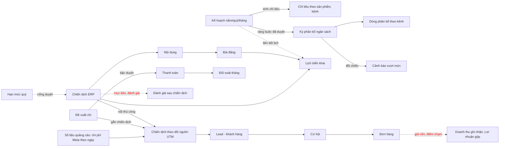
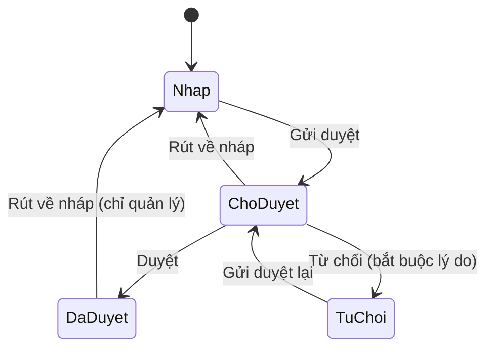

# URD-MKT-00 · Nền nghiệp vụ Phân hệ Marketing

| Ngày | Loại thay đổi (A/M/D) | Người sửa | Mô tả thay đổi | Phiên bản | Tham chiếu |
| --- | --- | --- | --- | --- | --- |
| 11/10/2026 | A | HoaNK | Tạo mới tài liệu nền nghiệp vụ Marketing: thuật ngữ, chỉ số, thực thể, trạng thái, phân quyền, quy tắc dùng chung, khoảng trống và quyết định của BA | V1.0.0 | Mockup `Mockup_Phân hệ MKT 101026 (update theo cmt)` |

*A - Tạo mới; M - Sửa đổi; D - Xóa bỏ*

## Mục lục

- [1. Tổng quan](#1-tổng-quan)
  - [1.1 Mục đích](#11-mục-đích)
  - [1.2 Phạm vi](#12-phạm-vi)
  - [1.3 Tổng quan chức năng: hệ thống hiện tại so với mockup](#13-tổng-quan-chức-năng-hệ-thống-hiện-tại-so-với-mockup)
  - [1.4 Bảng mã tham chiếu](#14-bảng-mã-tham-chiếu)
- [2. Từ điển thuật ngữ và chỉ số](#2-từ-điển-thuật-ngữ-và-chỉ-số)
  - [2.1 Đối tượng kinh doanh](#21-đối-tượng-kinh-doanh)
  - [2.2 Chỉ số và công thức](#22-chỉ-số-và-công-thức)
  - [2.3 Kỳ, tiến độ, so sánh](#23-kỳ-tiến-độ-so-sánh)
  - [2.4 Ngân sách và chi phí](#24-ngân-sách-và-chi-phí)
- [3. Mô hình dữ liệu và quan hệ](#3-mô-hình-dữ-liệu-và-quan-hệ)
- [4. Vòng đời và trạng thái](#4-vòng-đời-và-trạng-thái)
- [5. Phân quyền](#5-phân-quyền)
- [6. Quy tắc nghiệp vụ dùng chung](#6-quy-tắc-nghiệp-vụ-dùng-chung)
- [7. Nguồn dữ liệu và tần suất cập nhật](#7-nguồn-dữ-liệu-và-tần-suất-cập-nhật)
- [8. Khoảng trống giữa hệ thống hiện tại và yêu cầu](#8-khoảng-trống-giữa-hệ-thống-hiện-tại-và-yêu-cầu)
- [9. Quyết định của BA](#9-quyết-định-của-ba)
- [10. Danh sách URD con](#10-danh-sách-urd-con)

---

## 1. Tổng quan

### 1.1 Mục đích

Tài liệu này thống nhất **một cách hiểu duy nhất** về thuật ngữ, chỉ số, thực thể, trạng thái, quyền và quy tắc dùng chung của phân hệ Marketing. Các URD con (URD-MKT-01 đến URD-MKT-09) chỉ mô tả phần riêng của từng màn hình và **tham chiếu** về đây bằng các mã `TD-xx`, `TT-xx`, `ST-xx`, `BR-NEN-xx`, `CH-xx`. Khi hai tài liệu mâu thuẫn, tài liệu này thắng.

Lý do cần tài liệu nền: mockup hiện thể hiện giao diện và thao tác nhưng chưa nêu thành văn bản công thức, trạng thái, quyền và ngưỡng; nhiều chỗ mockup, hệ thống hiện tại và yêu cầu của DTS tính cùng một chỉ số theo cách khác nhau (xem mục 8).

### 1.2 Phạm vi

| Trong phạm vi (6 nhóm chức năng của mockup) | Ngoài phạm vi (đã có phân hệ riêng hoặc làm sau) |
| --- | --- |
| Bảng điều khiển Marketing | Hội thoại, bình luận, SLA phản hồi, xử lý lead: phân hệ CSKH |
| Kế hoạch (kế hoạch năm/quý/tháng, lịch triển khai, phân bổ ngân sách, chỉ tiêu theo sản phẩm và kênh) | Khách hàng, cơ hội, giai đoạn, bàn giao Sale: phân hệ CRM |
| Chiến dịch (đề xuất, đang chạy, đã kết thúc, đánh giá) | Quản lý kênh, kết nối tài khoản quảng cáo, Website và SEO, Google Ads, TikTok Ads: phân hệ quản lý kênh của bản cũ |
| Nội dung và media (yêu cầu, kế hoạch nội dung, lịch xuất bản, duyệt, lịch quay, kho, mẫu nhận diện) | Công việc, KPI: giai đoạn sau |
| Quản lý chi phí ngân sách (đề xuất chi, chờ duyệt, thanh toán, đối soát, cảnh báo vượt mức) | Thiết lập và quản trị: bản cũ đã có |
| Báo cáo dữ liệu (chi phí và lead, doanh thu ghi nhận, hiệu quả chiến dịch, báo cáo định kỳ) | |

Marketing **đọc** dữ liệu của CSKH, CRM và Sale (lead, cơ hội, đơn) nhưng không định nghĩa lại các đối tượng đó. Phần giao nhau được nêu ở mục 2 và mục 8.

### 1.3 Tổng quan chức năng: hệ thống hiện tại so với mockup

Đối chiếu giữa hệ thống hiện tại (tính đến 11/10/2026) và `Mockup_Phân hệ MKT 101026 (update theo cmt)`.

| Nhóm | Chức năng hệ thống hiện tại | Chức năng mới theo mockup/yêu cầu |
| --- | --- | --- |
| Bảng điều khiển | 4 màn: Tổng quan ngày, Cảnh báo cần xử lý, Phễu và hiệu quả (6 bước), Hiệu suất đội nhóm. Chỉ có bộ lọc kỳ. Không xem chi tiết từ số liệu, không biểu đồ | Bộ lọc dùng chung nhiều chiều; ô Khách tiềm năng đủ điều kiện, Đã mất chính xác, Lượt nhấp, Lưu lượng truy cập, ROI; phễu 7 bước có Lợi nhuận gộp; xem danh sách chi tiết từ số liệu; xử lý cảnh báo trực tiếp; 2 loại cảnh báo (Bàn giao Sale quá hạn, Nội dung chờ duyệt quá hạn) |
| Kế hoạch | Kế hoạch năm/quý/tháng có 1 chữ ký duyệt, mục tiêu, ngân sách dự kiến, mốc; chỉ tiêu sinh từ kế hoạch; lịch triển khai (hợp nhất từ 4 nguồn); kỳ phân bổ ngân sách có 5 trạng thái | Cảnh báo 80% và chặn 100% khi phân bổ; luồng Đề nghị tăng ngân sách và BGĐ duyệt; chỉ tiêu lợi nhuận gộp theo kênh; điều hướng lịch tháng/tuần |
| Chiến dịch | Hồ sơ chiến dịch có duyệt 2 cấp (nội dung, ngân sách), cổng hạn mức quý, đẩy sang Facebook, đồng bộ chiến dịch từ Meta | Mục tiêu định lượng (lead, doanh thu, độ phủ); trạng thái Đã kết thúc và chốt số liệu; tạm dừng/tiếp tục từ ERP; đánh giá sau chiến dịch; tự chạy theo ngày bắt đầu |
| Nội dung và media | Kho nội dung có duyệt và kiểm tuân thủ; bài đăng hẹn giờ lên Fanpage; kho tài nguyên | Yêu cầu nội dung; kế hoạch nội dung có duyệt; lịch quay chụp; mẫu và nhận diện; đăng đa nền tảng; liên kết buổi quay với kho |
| Quản lý chi phí | Đề xuất chi duyệt nhiều bậc theo số tiền, thanh toán, đối soát tháng, cảnh báo vượt mức (hệ thống tự quét mỗi giờ), khoản mục, bậc duyệt | Màn danh sách cảnh báo có lọc và gom nhóm; sửa ngưỡng cảnh báo trên màn |
| Báo cáo | Báo cáo Hiệu quả, Khung giờ, Bảng xếp hạng; báo cáo cơ hội, cuộc gọi, chỉ tiêu | Chi phí và lead theo kênh/chiến dịch có so kỳ trước và chia chỉ tiêu theo ngày; doanh thu ghi nhận có chi tiết đơn và ROI; hiệu quả chiến dịch; báo cáo ngày/tuần/tháng, email 09:00, luồng trình báo cáo tháng lên BGĐ; nạp giá vốn |

### 1.4 Bảng mã tham chiếu

| Tiền tố | Ý nghĩa |
| --- | --- |
| `TD-xx` | Thuật ngữ, chỉ số (mục 2) |
| `TT-xx` | Thực thể dữ liệu (mục 3) |
| `ST-xx` | Máy trạng thái (mục 4) |
| `QH-xx` | Quy tắc quyền (mục 5) |
| `BR-NEN-xx` | Quy tắc nghiệp vụ dùng chung (mục 6) |
| `G-xx` | Khoảng trống (mục 8) |
| `CH-xx` | Vấn đề đã có quyết định [SUGGESTION] của BA (mục 9) |

---

## 2. Từ điển thuật ngữ và chỉ số

### 2.1 Đối tượng kinh doanh

| Mã | Thuật ngữ | Định nghĩa | Nguồn dữ liệu | Ghi chú |
| --- | --- | --- | --- | --- |
| TD-01 | **Lead** (khách tiềm năng mới) | Một hồ sơ khách hàng được tạo trong kỳ. Một số điện thoại chuẩn hóa chỉ có **một** hồ sơ đang hoạt động, nên đếm lead là đếm số khách khác nhau, không đếm lượt liên hệ | bảng `khachhang`, cột `ngaytao`, chỉ `active = true`; chuẩn hóa `sodienthoai_chuan` | |
| TD-02 | **Khách tiềm năng đủ điều kiện** (lead đủ điều kiện) | Lead tạo trong kỳ có trạng thái thẩm định là hợp lệ và đủ các trường bắt buộc. Trường bắt buộc mặc định: họ tên, số điện thoại hợp lệ, nhãn sản phẩm quan tâm (cấu hình theo nguồn); tính khi lead được tạo hoặc sửa [SUGGESTION]. Không còn điều kiện "chưa bàn giao Sale" vì lead được chia cho Sale tự động theo thời gian thực (bước Chờ bàn giao Sale đã bị bỏ theo xác nhận của DTS) | `khachhang.trangthaithamdinh` có giá trị `chothamdinh`/`hople`/`khonghople`; "đủ trường bắt buộc" chưa có cột lưu: [SUGGESTION] thêm chỉ báo "lead đủ điều kiện" tính tự động, xem CH-03 | Cột thẩm định đã có; chức năng đặt trạng thái không hợp lệ chưa có |
| TD-03 | **Cơ hội** | Bản ghi cơ hội sinh từ lead khi được chia cho Sale. Không có hai cơ hội đang mở cùng (SĐT chuẩn hóa, nhãn sản phẩm) | bảng `cohoi` | Thuộc CRM |
| TD-04 | **Cơ hội mới** | Số cơ hội có ngày tạo trong kỳ, tính cả cơ hội đã lưu trữ | `cohoi.create_date`, tính cả bản ghi đã lưu trữ | |
| TD-05 | **Đã mất** | Số cơ hội **đóng trong kỳ** với lý do thất bại: ngày đóng của cơ hội nằm trong kỳ và giai đoạn đóng không phải "Thành công". Hệ thống hiện tại tính theo cơ hội **tạo trong kỳ** có giai đoạn hiện tại là đóng thất bại, không dùng ngày đóng | `cohoi.ngaydong` (ghi khi đóng), `cohoi.lydothatbai_id`, `giaidoan.coi_la_dadong`, `giaidoan.phanloai` | Các cột đã có đủ; công thức hiện tại khác định nghĩa trên (xem G-05) |
| TD-06 | **Đơn chốt** | Đơn hàng bán đã xác nhận có ngày đặt hàng trong kỳ. Báo giá (nháp, đã gửi) không tính. Đơn chốt là đơn ở trạng thái Đã xác nhận (kể cả đã khóa); đơn đã chốt bị hủy không tính; trả hàng hoặc hoàn tiền sau khi chốt chưa trừ [SUGGESTION] | bảng `sale.order`, trạng thái `sale`, cột `date_order` | |
| TD-07 | **Đơn có nguồn Marketing** | Đơn chốt gắn với một lead (qua cơ hội), tức xuất phát từ lead do Marketing tạo. Đơn Sale tự tạo không có nguồn lead thì **không** tính vào doanh thu Marketing | `sale.order.khachhang_id` (lấy từ cơ hội của đơn) | Bảng điều khiển hiện **đếm cả** đơn không có nguồn nếu có chiều marketing; cần thêm điều kiện đơn phải có lead nguồn (CH-05) |
| TD-08 | **Đội nhóm Marketing** | Một đội bán hàng/CRM được dùng làm đội Marketing. Hệ thống không phân biệt đội Marketing và đội bán hàng | `doinhommarketing_id` | Đội của lead suy ra từ nguồn/đường dẫn nên có thể rỗng |
| TD-09 | **Kênh**, **Nền tảng**, **Nguồn** | **Kênh marketing** = danh mục dùng cho chỉ tiêu, phân bổ, lead. **Nền tảng** = nơi chạy quảng cáo (Meta, Google, TikTok, Zalo, Website, Khác). **Nguồn khách hàng** = danh mục nguồn, mang theo nhãn/kênh/đội/nhân viên | danh mục nguồn khách hàng | Ba khái niệm hiện được dùng lẫn trong mockup (cần danh mục thống nhất, CH-14) |
| TD-10 | **Chiến dịch** | Có **3 lớp**: (1) hồ sơ chiến dịch ERP có duyệt và đẩy, mã `CMP-yymm-nn`; (2) chiến dịch theo dõi nguồn (UTM) dùng để gắn lead và báo cáo; (3) bản đọc từ Meta. Lớp 1 nối lớp 2 **chỉ bằng nhập tay** | xem mục 3 | Khoảng trống nối: G-08 |
| TD-11 | **Nhãn sản phẩm** | Danh mục nhãn sản phẩm, là chiều chung cho kế hoạch, chỉ tiêu, nguồn, cơ hội, tài khoản quảng cáo | bảng `nhansanpham` | |
| TD-12 | **Điểm chạm cuối** | Tương tác cuối cùng của khách trước thời điểm chốt đơn. Người ở điểm chạm cuối (Sale, nhân viên Marketing, người trực page) được ghi nhận doanh số. Hệ thống hiện tại gán doanh thu theo **nguồn lúc tạo cơ hội**, chỉ sao một lần khi chia, không cập nhật theo tương tác sau | chưa có bảng điểm chạm | G-12 |

### 2.2 Chỉ số và công thức

Mọi chỉ số dưới đây dùng cùng một **bộ lọc kỳ** (TD-30) và cùng **quy tắc chia cho 0** (BR-NEN-02). Công thức viết bằng các tập đếm riêng theo mốc thời gian của từng tập, **không** theo cohort (lead này sinh ra cơ hội nào, đơn nào).

| Mã | Chỉ số | Công thức | Nguồn dữ liệu | Ghi chú |
| --- | --- | --- | --- | --- |
| TD-13 | **Chi phí quảng cáo** (dùng cho CPL, ROAS, ROI) | Tổng chi phí của tài khoản quảng cáo trong kỳ: số liệu lấy tự động từ Meta cộng khoản thanh toán thuộc khoản mục "Quảng cáo trả phí" của kênh Google, TikTok (chưa có kết nối tự động). Zalo OA, Website/SEO, Giới thiệu, Hotline bằng 0 và hiển thị "—"; khoản thanh toán "Quảng cáo trả phí" của các kênh này không vào chi phí quảng cáo (CPL) nhưng vẫn vào đối soát. **Không** gồm chi phí khác như KOL, in ấn, sự kiện [SUGGESTION: theo yêu cầu DTS, CPL chỉ tính chi phí từ tài khoản quảng cáo Meta, Google, TikTok] Hệ thống hiện tại cộng **toàn bộ** thanh toán chi phí Marketing, không phân loại khoản mục | Chi phí thực = `baocao_quangcao.chi_phi` + thanh toán chi phí Marketing (`so_tien`) | Khác nhau về phạm vi: G-06, CH-06 |
| TD-14 | **CPL** (chi phí mỗi lead) | `Chi phí quảng cáo ÷ Lead` | tính từ TD-13 và TD-01 | Lead gồm **cả** lead tự nhiên (chi phí 0), nên CPL tổng không phải CPL của lead quảng cáo (CH-07) |
| TD-15 | **ROAS** | `Doanh thu ghi nhận ÷ Chi phí quảng cáo`, hiển thị dạng `n,n×` | tính từ TD-22 và TD-13 | |
| TD-16 | **ROI** | `(Doanh thu ghi nhận − Chi phí quảng cáo) × 100 ÷ Chi phí quảng cáo`. Là ROI **trên doanh thu**, không phải trên lợi nhuận | tính từ TD-22 và TD-13 | Khi có giá vốn, đề xuất thêm "ROI lợi nhuận gộp" (CH-04) |
| TD-17 | **Giá trị trung bình mỗi đơn** (AOV) | `Doanh thu ghi nhận ÷ Số đơn chốt` | tính từ TD-22 và TD-06 | |
| TD-18 | **Lead → Cơ hội** | `Cơ hội mới × 100 ÷ Lead` | tính từ TD-04 và TD-01 | |
| TD-19 | **Cơ hội → Đơn** | `Đơn chốt × 100 ÷ Cơ hội mới` | tính từ TD-06 và TD-04 | |
| TD-20 | **Lead → Đơn** | `Đơn chốt × 100 ÷ Lead` (còn gọi % chốt trên lead) | tính từ TD-06 và TD-01 | |
| TD-21 | **Tỷ lệ chuyển đổi** | Chỉ là **tên chung**; mỗi màn phải ghi rõ là TD-18, TD-19 hay TD-20. Mockup đang dùng nhãn "Tỷ lệ chuyển đổi" cho TD-18 ở Bảng điều khiển nhưng cho TD-20 ở báo cáo hiệu quả chiến dịch | | Lệch giữa màn: G-10 |
| TD-22 | **Doanh thu ghi nhận** | Tổng tiền của đơn chốt có nguồn Marketing (TD-07) trong kỳ theo ngày đặt hàng. Hiện gồm thuế, chưa trừ chiết khấu riêng. Đơn đã chốt bị hủy không tính; trả hàng hoặc hoàn tiền sau khi chốt chưa trừ; kỳ tính theo ngày đặt đơn [SUGGESTION] | `sale.order.amount_total`, `date_order` | Quy tắc thuế/chiết khấu cần chốt (CH-08) |
| TD-23 | **Giá vốn** | Giá vốn của từng đơn do DATYSO tự nạp (nhập tay hoặc tải CSV `ma_don, gia_von`). Giá vốn = 0 là hợp lệ, để trống nghĩa là chưa có | chưa có cột. Chỉ có giá vốn chuẩn trên sản phẩm của Odoo (không được dùng) và `cohoi.tongtiengoc` | G-01 |
| TD-24 | **Lợi nhuận gộp** | `Doanh thu ghi nhận − Giá vốn`, chỉ tính khi **mọi đơn trong phạm vi** đã có giá vốn; nếu còn đơn chưa có thì hiển thị "Chưa đủ giá vốn", không hiển thị lợi nhuận một phần | phụ thuộc TD-23 | |
| TD-25 | **Lượt hiển thị / Lượt nhấp / Tiếp cận** | Cộng từ số liệu quảng cáo theo ngày. Chỉ Facebook có nguồn số liệu tự động | `baocao_quangcao.hien_thi`, `nhap_chuot`, `tiep_can` | Chỉ Facebook. Bảng điều khiển hiện chưa dùng |
| TD-26 | **Độ phủ** | Số khách hàng tiếp cận (người xem duy nhất) của chiến dịch trong kỳ, so với mục tiêu tiếp cận, tính tại thời điểm xem. Từ "độ phủ" đang có **hai nghĩa**: chỉ tiêu phần trăm ở dòng mục tiêu kế hoạch và số khách tiếp cận tuyệt đối ở chiến dịch | `baocao_quangcao.tiep_can` (chỉ Facebook) | Dòng mục tiêu độ phủ có nhưng bị bỏ khi sinh chỉ tiêu (G-02, CH-09) |
| TD-27 | **Lưu lượng truy cập website** | Số phiên (session) của từng website theo kỳ, lấy từ GA4 | chưa có | G-04. Website thuộc phạm vi giai đoạn sau |

### 2.3 Kỳ, tiến độ, so sánh

| Mã | Thuật ngữ | Định nghĩa | Ghi chú |
| --- | --- | --- | --- |
| TD-30 | **Kỳ báo cáo** | Khoảng ngày theo lịch Việt Nam (`Asia/Ho_Chi_Minh`). Hệ thống hiện tại: Ngày, Tuần (thứ 2 đến Chủ nhật), Tháng, Năm, Tùy chỉnh, mặc định Tháng. Mockup: Hôm nay, Hôm qua, 7 ngày, Tháng này, Tùy chọn, mặc định Hôm nay. Ngày được đổi sang giờ UTC `[00:00 ngày đầu, 00:00 ngày cuối + 1)` | Danh sách kỳ khác nhau: CH-10 |
| TD-31 | **Kỳ trước** | Khoảng liền ngay trước kỳ này **cùng số ngày** (28 ngày thì lấy 28 ngày liền trước; một ngày thì lấy hôm trước). Không phải "cùng kỳ tháng trước" hay "năm trước". "7 ngày" gồm hôm nay và 6 ngày liền trước; "Tháng này" từ mùng 1 đến hôm nay [SUGGESTION] | Mockup ghi nhãn "cùng khung giờ" nhưng chưa tính theo giờ: CH-11 |
| TD-32 | **% so với kỳ trước** | `(Kỳ này − Kỳ trước) × 100 ÷ Kỳ trước`. Nếu kỳ trước bằng 0 hoặc không có: hiển thị "—" (chưa có kỳ trước), không hiển thị phần trăm vô cực | Màu: tăng tốt hiển thị xanh, tăng xấu (Chi phí, CPL) hiển thị đỏ |
| TD-33 | **% thời gian đã qua** (tiến độ kỳ) | `(Hôm nay − Ngày đầu + 1) × 100 ÷ Tổng ngày kỳ`; 0 nếu chưa bắt đầu, 100 nếu đã qua. Riêng kỳ "Hôm nay" tính theo giờ làm việc 8:00 đến 18:00: trước 8:00 là 0%, sau 18:00 là 100%; kỳ chứa hôm nay (7 ngày, Tháng này) cộng thêm phần giờ làm việc của hôm nay; ngày nghỉ tính như ngày thường [SUGGESTION] | Hiện tính theo ngày; phần giờ làm việc là mới |
| TD-34 | **Chậm / Đúng / Đi trước tiến độ** | So % đạt chỉ tiêu (TD-35) với % thời gian đã qua (TD-33). Hệ thống hiện tại: **chậm** khi `% đạt < % thời gian`. Mockup có dung sai 3 điểm phần trăm: chậm khi `% đạt < % thời gian − 3`; đúng tiến độ khi chênh trong ±3; đi trước khi vượt +3 | Khác nhau giữa mockup và hệ thống hiện tại: CH-12 |
| TD-35 | **% đạt chỉ tiêu** | `Thực tế × 100 ÷ Chỉ tiêu`; chỉ tiêu bằng 0 thì "—". Hệ thống hiện tại tính trên **chỉ tiêu cả kỳ giao**; mockup tính trên chỉ tiêu đã chia theo số ngày giao nhau với kỳ đang xem (BR-NEN-05) | |

### 2.4 Ngân sách và chi phí

| Mã | Thuật ngữ | Định nghĩa | Nguồn dữ liệu | Ghi chú |
| --- | --- | --- | --- | --- |
| TD-40 | **Ngân sách kế hoạch** | Tổng số tiền các dòng ngân sách dự kiến theo kênh của kế hoạch | tổng `so_tien` các dòng ngân sách dự kiến | |
| TD-41 | **Kỳ phân bổ / Dòng phân bổ** | Kỳ phân bổ gắn một kế hoạch **đã duyệt**; mỗi dòng phân bổ theo kênh và tùy chọn chiến dịch, nhãn sản phẩm | bảng kỳ phân bổ và dòng phân bổ | |
| TD-42 | **Ngân sách chiến dịch** | Tổng ngân sách do người lập nhập; **ngân sách đã duyệt** = tổng ngân sách khi trạng thái thuộc nhóm đã cam kết (đã duyệt, đang đẩy, đã đẩy, đang chạy, kết thúc) | `tong_ngansach` của chiến dịch | |
| TD-43 | **Hạn mức quý** | Trần ngân sách quý của từng công ty con (`ke_hoach`), **nhập tay**, độc lập với kế hoạch Marketing. Còn lại = hạn mức − tổng ngân sách chiến dịch đã cam kết có ngày bắt đầu trong quý | bảng hạn mức quý | Tên "Kế hoạch quý" ở đây **khác** kế hoạch Marketing loại quý |
| TD-44 | **Chi phí thực** | Một cửa duy nhất tổng hợp chi phí thực (xem TD-13). Chi phí thực = chi phí quảng cáo đồng bộ từ nền tảng cộng khoản đã thanh toán của đề xuất chi đã duyệt; không âm; không gồm chi phí bổ sung ngoài nền tảng (TD-46). Chi tiết ở URD-MKT-03, BR_23 | nguồn chi phí thực | |
| TD-45 | **% đã dùng ngân sách** | `Chi thực × 100 ÷ Ngân sách`. Trạng thái dòng phân bổ: dưới 80% bình thường, từ 80% đến 100% **sắp vượt**, trên 100% **vượt** (đúng 100% vẫn là "sắp vượt") | | Mockup coi đạt 100% là mức chặn: BR-NEN-06 |
| TD-46 | **Chi phí bổ sung ngoài nền tảng** | Khoản chi nhập tay theo chiến dịch. Hiện **không** vào cửa chi phí thực nên không xuất hiện ở chỉ tiêu, phân bổ, đối soát | bảng `chiphi_bosung_chiendich` | Đã có nhưng tách riêng (G-07) |

---

## 3. Mô hình dữ liệu và quan hệ

### 3.1 Danh mục thực thể

Tên bảng dữ liệu viết theo tên hệ thống. Mã chứng từ do hệ thống tự sinh.

| Mã | Thực thể | Tên bảng dữ liệu | Mã tự sinh | Trường chính | Ghi chú |
| --- | --- | --- | --- | --- | --- |
| TT-01 | Kế hoạch Marketing | `datyso.mkt.kehoach` | `MKT-KH-0001` | `loai_ky` (năm/quý/tháng), `kehoach_cha_id`, `ngay_tu`, `ngay_den`, `state`, `tong_ngansach`, `thanhvien_ids` | |
| TT-02 | Mục tiêu kế hoạch | `datyso.mkt.kehoach.muctieu` | | `chi_so` (lead, doanh thu, độ phủ, CPL), `nhansanpham_id`, `kenh_id`, `gia_tri` | |
| TT-03 | Ngân sách dự kiến | `datyso.mkt.kehoach.ngansach` | | `kenh_id`, `chiendich_id`, `so_tien` | |
| TT-04 | Mốc triển khai | `datyso.mkt.kehoach.moc` | | `ngay_tu`, `ngay_den`, `hoan_thanh`; trạng thái tính theo ngày | |
| TT-05 | Chỉ tiêu Marketing | `datyso.mkt.chitieu` | `MKT-CT-0001` | `loai` (sản phẩm/kênh), `kehoach_id`, `chi_tieu_lead`, `chi_tieu_doanhthu`, `cpl_muctieu`; số thực tế tính từ lead, đơn, chi phí | Chưa có chỉ tiêu lợi nhuận gộp |
| TT-06 | Lịch triển khai | `datyso.mkt.lich` | | hợp nhất từ 4 nguồn: mốc, chiến dịch, bài đăng, nội dung chưa lên lịch; `trang_thai` tính theo ngày | |
| TT-07 | Kỳ phân bổ, dòng phân bổ | `datyso.mkt.phanbo`, `.dong` | `MKT-PB-0001` | `kehoach_id` (phải đã duyệt), `ngay_tu`, `ngay_den`, `kenh`, `so_tien`, `da_dung` | |
| TT-08 | Hạn mức quý | `datyso.ads.hanmuc` | | `nam`, `quy`, `congtycon_id`, `ke_hoach` | |
| TT-09 | Chiến dịch | `datyso.ads.chiendich` | `CMP-yymm-nn` | `tieu_de`, `doinhommarketing_id`, `utm_campaign_id`, `muc_tieu` (4 loại), `ngay_bat_dau`, `ngay_ket_thuc`, `tong_ngansach`, `state`, `nguon` | Chưa có mục tiêu lead, doanh thu, độ phủ dạng số |
| TT-10 | Chiến dịch từ Meta (đồng bộ) | `datyso.ads.chiendich_fb` | | `facebook_campaign_id`, `chi_thuc`, `hien_thi`, `nhap_chuot`, cờ cảnh báo | |
| TT-11 | Nội dung | `datyso.ads.noidung` | `ND-yymm-001` | `name`, `loai_id`, `state`, `tuanthu_state`, `ngay_dang_kien`, `taynguyen_ids` | |
| TT-12 | Bài đăng | `datyso.ads.baidang` | | `noidung_id` (phải đã duyệt), `kenh_id` (Fanpage), `gio_dang`, `state` | |
| TT-13 | Tài nguyên media | `datyso.ads.taynguyen`, `.thumuc` | | `tep`, `loai`, `bam` (SHA-256), `nhansanpham_ids` | Trần 20 MB mỗi tệp |
| TT-14 | Đề xuất chi | `datyso.mkt.dexuatchi` | `MKT-DX-0001` | `khoanmuc_id`, `kenh`, `utm_campaign_id`, `so_tien`, `ngay_chi`, `state`, bước duyệt | |
| TT-15 | Bậc duyệt chi | `datyso.mkt.chi.capduyet` | | `nguong_tu`, `nhom_duyet_id` | Cấu hình ban đầu: 0, 20 triệu, 100 triệu |
| TT-16 | Thanh toán | `datyso.mkt.thanhtoan` | | `dexuat_id`, `so_tien`, `phuongthuc`, `chungtu_ids` (bắt buộc) | |
| TT-17 | Đối soát tháng | `datyso.mkt.doisoat`, `.dong` | | `nam`, `thang`, `state`, dòng kênh/chiến dịch | |
| TT-18 | Cảnh báo vượt mức | `datyso.mkt.canhbao`, `.nguong` | `MKT-CB-0001` | `muc`, `ty_le_thuc`, `da_xu_ly` | |
| TT-19 | Số liệu quảng cáo | `baocao_quangcao` | | một dòng = một quảng cáo × một ngày; `chi_phi`, `hien_thi`, `tiep_can`, `nhap_chuot` | Chỉ Facebook |
| TT-20 | Lead (khách hàng) | `khachhang` | `KH000001` | `ngaytao`, `sodienthoai_chuan`, `trangthaithamdinh`, `chiendich_id`, `kenhmarketing_id`, `doinhommarketing_id` | Thuộc CRM |
| TT-21 | Cơ hội | `cohoi` | | `khachhang_id`, `giaidoan_id`, `ngaydong`, `lydothatbai_id` | Thuộc CRM |
| TT-22 | Đơn hàng | `sale.order` | | `cohoi_id`, `chiendich_id`, `kenhmarketing_id`, `date_order` | Thuộc Sale |
| TT-30 | Yêu cầu nội dung | chưa có | YC/2026/nnnn | tên, định dạng (bài viết/ảnh/video), người yêu cầu, người thực hiện, hạn, kênh, phiên bản, trạng thái | G-09 |
| TT-31 | Kế hoạch nội dung | chưa có | KN/2026/nnnn | kỳ, dòng chủ đề (định dạng, kênh, ngày, người), trạng thái có duyệt | |
| TT-32 | Lịch quay chụp | chưa có | LQ/2026/nnnn | địa điểm, giờ bắt đầu và kết thúc, ê-kíp, tư liệu bàn giao | |
| TT-33 | Mẫu và nhận diện | chưa có | ND/nnnn | loại (logo, font, bảng màu, template), phiên bản, hướng dẫn | |
| TT-34 | Đánh giá sau chiến dịch | chưa có | DG/2026/nnnn | số liệu chốt, bài học, đề xuất, xác nhận, case mẫu | |
| TT-35 | Giá vốn đơn | chưa có | | `ma_don`, `gia_von`, nhật ký nạp | G-01 |
| TT-36 | Điểm chạm đơn | chưa có | | thời điểm, loại, kênh, Sale, nhân viên Marketing, người trực page | G-12 |
| TT-37 | Báo cáo định kỳ và luồng trình | chưa có | | loại (ngày/tuần/tháng), kỳ, trạng thái Nháp, Đã trình, BGĐ đã xem, Trả lại; nhận xét; lịch gửi email | G-11 |

### 3.2 Quan hệ

**Hai chuỗi gặp nhau ở chiến dịch theo dõi nguồn (UTM):** chuỗi lead đến doanh thu đi qua trường chiến dịch trên khách hàng (`khachhang.chiendich_id`), cơ hội (`cohoi.chiendich_id`) và đơn hàng (`sale.order.chiendich_id`); chuỗi chi phí đi qua trường chiến dịch trên số liệu quảng cáo (`baocao_quangcao.chiendich_id`). Hồ sơ chiến dịch ERP chỉ gặp chiến dịch theo dõi nguồn khi người dùng chọn tay, nên chỉ tiêu theo nhãn/kênh, phân bổ theo chiến dịch và bảng điều khiển chỉ tính được chi phí cho chiến dịch đã nối.

---

## 4. Vòng đời và trạng thái

Quy tắc chung: **người lập không tự duyệt** phiếu của mình. Mọi chuyển trạng thái đều ghi người, thời điểm, lý do (trong lịch sử của phiếu). Trạng thái không được sửa trực tiếp, chỉ đổi qua các nút chức năng.

### ST-01 Kế hoạch Marketing

| Trạng thái | Chuyển | Ai | Điều kiện, hiệu ứng |
| --- | --- | --- | --- |
| Nháp, Từ chối → **Chờ duyệt** | Gửi duyệt | người có quyền ghi | xóa lý do từ chối |
| Chờ duyệt → **Đã duyệt** | Duyệt | Trưởng/Phó phòng, BGĐ | ghi người, ngày duyệt. Khóa sửa mọi trường và dòng con (mốc còn sửa được trạng thái hoàn thành và ghi chú). Mockup chặn người lập tự duyệt; hệ thống hiện tại chưa chặn |
| Chờ duyệt → **Từ chối** | Từ chối | Trưởng/Phó phòng, BGĐ | **bắt buộc** lý do |
| Chờ duyệt, Từ chối → **Nháp** | Rút về nháp | người có quyền ghi | |
| Đã duyệt → **Nháp** | Rút về nháp | chỉ Trưởng/Phó phòng, BGĐ | hủy chữ ký duyệt; chỉ tiêu và phân bổ đã sinh được giữ nhưng không còn căn cứ đã duyệt (CH-13) |
| Đã duyệt | Sinh chỉ tiêu | người có quyền ghi chỉ tiêu | chỉ khi đã duyệt; bỏ dòng độ phủ và dòng không có nhãn/kênh; gộp theo (nhãn, kênh, trang): lead và doanh thu **cộng dồn**, CPL **ghi đè**; bấm lại thì cập nhật, không nhân đôi |

Cây kế hoạch: tháng chỉ treo vào quý, quý vào năm; kỳ con phải nằm trong kỳ cha. Chưa kiểm tổng ngân sách và mục tiêu của con so với cha (CH-15).

### ST-02 Kỳ phân bổ ngân sách

| Trạng thái | Chuyển | Ai | Ghi chú |
| --- | --- | --- | --- |
| Đang phân bổ → **Chờ duyệt** | Gửi duyệt | người có quyền ghi | Điều kiện Gửi duyệt và Xóa kỳ (chỉ khi Đang phân bổ): URD-MKT-03, BR_05, BR_25 |
| Chờ duyệt → **Đã duyệt** | Duyệt | Trưởng/Phó phòng, BGĐ | |
| Chờ duyệt, Đã duyệt → **Đang phân bổ** | Về nháp | Trưởng/Phó phòng, BGĐ | |
| Đã duyệt ⇄ **Đã khóa** | Khóa, Mở khóa | Trưởng/Phó phòng, BGĐ | Đã khóa không về nháp trực tiếp, phải Mở khóa về Đã duyệt trước |
| Đã khóa → **Đã đóng kỳ** | Đóng kỳ | Trưởng/Phó phòng, BGĐ | không mở lại; chỉ đóng được khi kỳ đang Đã khóa và đã qua ngày kết thúc kỳ (BR_05) |
| Chặn tăng khi tổng phân bổ ≥ 100% ngân sách kế hoạch; muốn tăng phải Đề nghị tăng ngân sách, BGĐ duyệt | | | xem BR-NEN-06 |

### ST-03 Chiến dịch

Hệ thống hiện tại có 9 trạng thái: Mới đồng bộ, Nháp, Chờ duyệt nội dung, Chờ duyệt ngân sách, Đã duyệt, Đang đẩy sang Facebook, Đã đẩy (tạm dừng), Đang chạy, Từ chối.

| Chuyển | Ai | Điều kiện |
| --- | --- | --- |
| Nháp, Từ chối → **Chờ duyệt nội dung** (Gửi duyệt) | người lập | cổng: có Đội chủ, ngày kết thúc, mọi nhóm quảng cáo có đội, mọi quảng cáo có nhân viên; ngân sách nhóm khớp; **chặn cứng** nếu quý đã khai hạn mức và tổng ngân sách chiến dịch lớn hơn hạn mức còn lại (quý chưa khai hạn mức thì cho qua và gắn cờ) |
| Chờ duyệt nội dung → **Chờ duyệt ngân sách** | Trưởng Đội chủ (Trưởng/Phó phòng ký thay) | không tự duyệt |
| Chờ duyệt ngân sách → **Đã duyệt** | Trưởng/Phó phòng, BGĐ | ngưỡng cấu hình ban đầu của cả hai cấp = 0 nên **luôn 2 cấp** bất kể số tiền |
| Chờ duyệt → **Nháp** (yêu cầu chỉnh sửa), → **Từ chối** | người ký | bắt buộc ý kiến |
| Đã duyệt → Đang đẩy → **Đã đẩy** (tạm dừng trên Meta) | nút đẩy hoặc hệ thống tự quét mỗi 5 phút | tài khoản đã kết nối, có hạn mức quý và còn lại ≥ 0, nhóm và quảng cáo đủ |
| Đã đẩy → **Đang chạy** | Trưởng/Phó phòng bật, hoặc đồng bộ thấy đang chạy trên Meta | |
| Đã duyệt/Đang chạy → **Chờ duyệt nội dung** | tự động | khi đổi tổng ngân sách hoặc Đội chủ sau khi gửi duyệt: mọi chữ ký rụng, duyệt lại |
| Duyệt ngân sách → tự chạy nếu ngày bắt đầu ≤ hôm nay, nếu không hẹn 07:00 ngày bắt đầu | | CH-16 |
| Đang chạy → **Tạm dừng**, **Tiếp tục** (cờ, không đổi trạng thái); Đang chạy → **Đã kết thúc** (kết thúc sớm hoặc hết hạn 23:55 ngày kết thúc), số liệu chốt không đổi nữa | người phụ trách hoặc Trưởng nhóm trở lên | Hệ thống hiện tại có nhắc đến trạng thái kết thúc nhưng chưa có trong danh sách trạng thái (G-13) |
| Đã kết thúc → **Đánh giá** (Nháp, Đã xác nhận, tùy chọn case mẫu) | xác nhận: Trưởng nhóm trở lên | TT-34 |

### ST-04 Nội dung, Yêu cầu nội dung, Kế hoạch nội dung, Bài đăng

**Nội dung (kho nội dung, đã có):** Nháp, Yêu cầu sửa → **Chờ duyệt** (chạy kiểm tuân thủ trước; vi phạm mức "chặn" thì giữ nguyên trạng thái) → **Đã duyệt** (Trưởng nhóm trở lên; kiểm tuân thủ lại) hoặc **Yêu cầu sửa** (bắt buộc lý do). Khóa tên, nội dung chữ, tệp khi Chờ duyệt/Đã duyệt.

**Bài đăng (đã có):** Đã hẹn giờ → Đang đăng → Đã đăng hoặc Lỗi (hệ thống tự quét mỗi 5 phút); Lỗi → Đã hẹn giờ (thử lại); Đã hẹn giờ, Lỗi → Đã hủy. Chỉ đăng nội dung **đã duyệt** và kiểm tuân thủ đạt.

**Yêu cầu nội dung** (mới): Mới → Đã giao → Đang sản xuất → Chờ duyệt → Hoàn thành. Chờ duyệt có phiên bản, hạn duyệt theo cam kết 480 phút làm việc; người nộp không tự duyệt; Yêu cầu sửa bắt buộc nhận xét.

**Kế hoạch nội dung** (mới): Nháp → Chờ duyệt → Đã duyệt hoặc Từ chối (bắt buộc lý do) → Hoàn thành (đóng kỳ). **Chỉ yêu cầu nội dung thuộc kế hoạch nội dung đã duyệt mới được lên lịch xuất bản** (CH-17: yêu cầu không thuộc kế hoạch nào thì xử lý ra sao).

### ST-05 Đề xuất chi, Thanh toán, Đối soát

| Trạng thái | Chuyển | Ai, điều kiện |
| --- | --- | --- |
| Nháp, Từ chối → **Chờ duyệt** | Gửi duyệt | người đề xuất hoặc quản lý. Ghi lại ngân sách phân bổ và lũy kế đã dùng tại thời điểm gửi; tạo bước duyệt theo số tiền; mở bước đầu (bắt đầu tính hạn) |
| Chờ duyệt → bước kế → **Đã duyệt** | Duyệt | người ký thuộc nhóm đúng bậc đang chờ và **không phải** người đề xuất. Hạn mỗi bậc 600 phút giờ làm việc. Mockup ghi 480 phút: CH-18 |
| Chờ duyệt → **Từ chối** | Từ chối | như trên, bắt buộc ý kiến |
| Đã duyệt → **Đã thanh toán** | Ghi nhận thanh toán | thanh toán bắt buộc chứng từ; tổng thanh toán ≤ số tiền đề xuất; chỉ tạo khi đề xuất Đã duyệt |
| Đã thanh toán → **Đã đối soát** | Chốt kỳ đối soát | Trưởng/Phó phòng, BGĐ |
| Đối soát: Mở → **Đã chốt** | Chốt kỳ | cần có dòng; sau chốt không sửa, không lập lại. Mockup cho chốt khi còn dòng vượt sau khi xác nhận "Vẫn chốt" |

Bậc duyệt: **trên 0** Trưởng nhóm; **trên 20 triệu** thêm Trưởng/Phó phòng; **trên 100 triệu** thêm BGĐ. So sánh **nghiêm ngặt** (đúng 20.000.000 chỉ cần Trưởng nhóm). Ngưỡng 20 và 100 triệu là giả định khởi điểm trong dữ liệu cấu hình ban đầu. Duyệt **tuần tự** theo bậc.

### ST-06 Báo cáo tháng

Nháp → Đã trình (Trưởng phòng Marketing trình, bắt buộc nhận xét) → BGĐ đã xem (ý kiến tùy chọn) hoặc Trả lại (ý kiến bắt buộc) → Trưởng phòng sửa nhận xét và trình lại. Mỗi bước ghi người, thời điểm, nội dung. Luồng này là **đề xuất của BA** từ phản hồi "cung cấp luồng trình duyệt"; DTS chưa xác nhận chi tiết (CH-19).

---

## 5. Phân quyền

### 5.1 Nhóm và vai trò

Quyền theo nhóm người dùng, kế thừa nhau: nhóm cao có mọi quyền của nhóm thấp.

| Vai trò nghiệp vụ | Ghi chú |
| --- | --- |
| Chuyên viên Marketing | thấy dữ liệu của mình hoặc do mình tạo |
| Trưởng nhóm Marketing | thấy dữ liệu đội mình (trưởng hoặc thành viên đội) |
| Trưởng/Phó phòng Marketing | thấy toàn bộ. **Không tách** Trưởng phòng và Phó phòng |
| Ban giám đốc | kế thừa quản lý; trong bảng điều khiển không khác Trưởng phòng |
| Trưởng phòng Sale | **không có** quyền trên dữ liệu quảng cáo và dữ liệu Marketing (kế hoạch, phân bổ, chi phí...) |
| Quản trị hệ thống | chỉ cấu hình (cấp duyệt, tài khoản quảng cáo) |

Mockup có 4 vai trò (Chuyên viên, Trưởng nhóm, Trưởng phòng, BGĐ) cộng Trưởng phòng Sale ở màn báo cáo. Chữ "Trưởng/Phó phòng" xuất hiện trong giao diện nhưng chỉ có một cấp.

### 5.2 Phạm vi dữ liệu theo tầng

Phạm vi dữ liệu 3 tầng áp lên lead, cơ hội và đơn hàng:

| Tầng | Điều kiện |
| --- | --- |
| Quản lý, BGĐ | toàn bộ |
| Trưởng nhóm | là trưởng đội Marketing hoặc thành viên của đội Marketing của bản ghi |
| Chuyên viên | là nhân viên Marketing của bản ghi hoặc là người tạo bản ghi |

Dữ liệu Marketing (kế hoạch, chỉ tiêu, phân bổ, đề xuất chi, chiến dịch, nội dung, bài đăng, cảnh báo) dùng cùng khuôn 3 tầng: của mình, của đội, toàn bộ.

### 5.3 Ma trận quyền (QH)

`Y` = được, `N` = không. Cột Ghi chú nêu khác biệt giữa mockup và hệ thống hiện tại.

| Mã | Năng lực | CV | TN | TP/Phó | BGĐ | Ghi chú |
| --- | --- | --- | --- | --- | --- | --- |
| QH-01 | Tạo, sửa kế hoạch, mục tiêu, ngân sách, mốc | Y | Y | Y | Y | Chuyên viên không xóa kế hoạch |
| QH-02 | Duyệt, từ chối kế hoạch; rút kế hoạch đã duyệt về nháp | N | N | Y | Y | Mockup chặn người lập tự duyệt |
| QH-03 | Gửi duyệt, duyệt, khóa, đóng kỳ phân bổ | gửi: N | gửi: Y | Y | Y | Chuyên viên chỉ đọc kỳ phân bổ |
| QH-04 | Lưu phân bổ khi đã đủ 100%, Đề nghị tăng ngân sách | N | N | Y | Y | BGĐ duyệt tăng; không cho BGĐ tự gửi tự duyệt (CH-20) |
| QH-05 | Tạo, sửa chiến dịch; gửi duyệt | Y | Y | Y | Y | Theo phạm vi đội/người |
| QH-06 | Duyệt nội dung chiến dịch (cấp 1) | N | chỉ Trưởng Đội chủ | Y (ký thay) | Y | |
| QH-07 | Duyệt ngân sách chiến dịch (cấp 2), bật chạy thật | N | N | Y | Y | Mockup: Trưởng phòng ghi đè hạn mức quý khi xác nhận "Vẫn duyệt"; hệ thống hiện tại **chặn cứng** |
| QH-08 | Tạm dừng, tiếp tục, kết thúc sớm, lập đánh giá chiến dịch | người phụ trách | Y | Y | Y | |
| QH-09 | Soạn nội dung; gửi duyệt; lên lịch đăng | Y | Y | Y | Y | |
| QH-10 | Duyệt, yêu cầu sửa, trả nháp nội dung | N | Y | Y | Y | |
| QH-11 | Tạo đề xuất chi | Y | Y | Y | Y | |
| QH-12 | Duyệt đề xuất chi bậc 1, bậc 2, bậc 3 | N | bậc 1 | bậc 1-2 | bậc 1-3 | Người đề xuất không tự duyệt |
| QH-13 | Ghi nhận thanh toán | N | N | Y (chỉ tạo) | Y | Mockup chưa kiểm vai trò |
| QH-14 | Lập bảng và chốt đối soát tháng | N | N | Y | Y | |
| QH-15 | Cấu hình khoản mục, ngưỡng cảnh báo; bậc duyệt chi | N | N | khoản mục, ngưỡng: Y | tất cả: Y | Bậc duyệt chi chỉ BGĐ sửa |
| QH-16 | Xem báo cáo Hiệu quả, Khung giờ, Bảng xếp hạng | N | Y | Y | Y | Chuyên viên bị chặn cả khi truy cập trực tiếp ngoài giao diện |
| QH-17 | Xem Bảng điều khiển | thấy của mình | đội mình | toàn bộ | toàn bộ | Hiệu suất đội nhóm chỉ hiện menu từ Trưởng nhóm |
| QH-18 | Mở danh sách đơn hàng (xem chi tiết từ số liệu) | N | Y | Y | Y | Quyền hiển thị đã khóa theo vai trò; **chưa có** chức năng xem chi tiết đơn từ số liệu |
| QH-19 | Xem nguồn, điểm chạm của đơn | N | N | Y | Y; Trưởng phòng Sale: Y | Theo phản hồi của DTS |
| QH-20 | Nạp giá vốn | N | N | Y | Y | [SUGGESTION] Trưởng phòng Marketing, Trưởng phòng Sale, BGĐ (CH-21) |
| QH-21 | Trình báo cáo tháng lên BGĐ; BGĐ đã xem hoặc trả lại | N | N | trình: Y | xem, trả lại: Y | |
| QH-22 | Sửa ngưỡng cảnh báo trên màn Cảnh báo vượt mức | N | N | Y | Y | [SUGGESTION] Trưởng/Phó phòng, BGĐ (CH-22). Hiện chỉ cho quản lý sửa ở màn cấu hình |

---

## 6. Quy tắc nghiệp vụ dùng chung

| Mã | Quy tắc |
| --- | --- |
| BR-NEN-01 | **Múi giờ và ngày.** Mọi "ngày" tính theo `Asia/Ho_Chi_Minh`; khi truy vấn đổi sang giờ UTC theo `[00:00 ngày đầu, 00:00 ngày cuối + 1)`. "Hôm nay" của kỳ do máy chủ xác định, không lấy ngày UTC của trình duyệt (giao diện hiện tại lấy ngày theo giờ UTC nên lệch một ngày trước 07:00 sáng: lỗi cần sửa) |
| BR-NEN-02 | **Chia cho 0.** Mẫu số bằng 0 hoặc không có thì kết quả là "không xác định", hiển thị **"—"**. Giá trị biết rõ và bằng 0 hiển thị **"0"**. Ví dụ: CPL bằng 0 khi có lead nhưng chi phí bằng 0; ROAS là "—" khi chi phí bằng 0. Ngoại lệ có chủ đích: **CPL của kênh không có chi phí quảng cáo** (BR-NEN-13) hiển thị "—" thay vì "0 đ" ở màn Chỉ tiêu theo kênh (URD-MKT-03, BR_13) |
| BR-NEN-03 | **Kỳ trước và so sánh** theo TD-31, TD-32. Khi đang áp bộ lọc nhiều chiều, chỉ hiển thị so sánh nếu có số kỳ trước **đã lọc cùng điều kiện**; nếu không có thì hiển thị "—" kèm lời giải thích, không để ô trống |
| BR-NEN-04 | **Ngưỡng tiến độ.** Chậm tiến độ khi % đạt thấp hơn % thời gian đã qua quá 3 điểm phần trăm; đúng tiến độ khi chênh trong ±3; đi trước khi vượt +3. Dùng thống nhất cho doanh thu, lead, từng đội, chỉ tiêu theo sản phẩm và kênh (CH-12) |
| BR-NEN-05 | **Chia chỉ tiêu theo ngày.** Chỉ tiêu kỳ xem = Chỉ tiêu × số ngày giao nhau giữa kỳ xem và kỳ của chỉ tiêu ÷ số ngày của kỳ chỉ tiêu (tháng, quý hoặc năm, từ ngày bắt đầu đến ngày kết thúc). % đạt chỉ đếm phần thực tế nằm trong khoảng giao nhau. Hệ thống hiện tại **không chia**: cộng trọn chỉ tiêu của mọi chỉ tiêu giao với kỳ (có thể cộng kép) (G-03, CH-23) |
| BR-NEN-06 | **Ngân sách: cảnh báo 80%, chặn 100%.** Hệ thống hiện tại: dòng phân bổ từ 80% là "sắp vượt", trên 100% là "vượt"; hệ thống tự quét mỗi giờ và gửi cảnh báo **một lần cho mỗi mốc cao nhất** của mỗi đối tượng (không gửi lại dù đã xử lý); chỉ **chặn cứng** khi duyệt chiến dịch vượt hạn mức quý còn lại. Yêu cầu DTS: từ 80% ngân sách dự kiến của kế hoạch thì cảnh báo, đạt 100% thì chặn tăng phân bổ; muốn tăng phải được cấp trên duyệt mở ngân sách. [SUGGESTION] Tính trên **tổng ngân sách kế hoạch**, áp cho phân bổ (80% cảnh báo, 100% chặn tạo thêm phân bổ); đề xuất chi vượt chỉ cảnh báo, không chặn; muốn tăng thì dùng luồng Đề nghị tăng ngân sách do cấp trên duyệt (CH-24) |
| BR-NEN-07 | **Không tự duyệt.** Người lập/đề xuất/nộp không được duyệt chính phiếu của mình ở: kế hoạch, chiến dịch (cả 2 cấp), nội dung, đề xuất chi. Áp thêm cho kế hoạch nội dung và đề nghị tăng ngân sách (hiện mockup chưa chặn) |
| BR-NEN-08 | **Cam kết thời gian duyệt (SLA).** Đề xuất chi: 600 phút giờ làm việc mỗi bậc, tính từ lúc bậc đó đến lượt. Duyệt nội dung: 480 phút làm việc; quá hạn thì gắn "Quá hạn duyệt" và vào cảnh báo. Giờ làm việc theo lịch làm việc của hệ thống (CH-18) |
| BR-NEN-09 | **Chống trùng.** 1 SĐT chuẩn hóa = 1 khách đang hoạt động; không hai cơ hội đang mở cùng (SĐT, nhãn); dữ liệu nhận từ nền tảng bên ngoài không bị ghi lặp (theo kênh và mã của nền tảng); mỗi quảng cáo mỗi ngày chỉ có một dòng chi phí |
| BR-NEN-10 | **Doanh thu chỉ tính đơn có nguồn Marketing.** Đơn do Sale tự tạo không có lead nguồn thì không vào doanh thu Marketing, không vào "(Chưa gắn kênh)" (TD-07). Bảng điều khiển hiện đếm cả đơn không có nguồn |
| BR-NEN-11 | **Ghi nhận theo điểm chạm cuối.** Doanh thu thuộc kênh và chiến dịch của lead nguồn; **doanh số cá nhân** (Sale, nhân viên Marketing, người trực page) ghi cho người ở điểm chạm cuối trước lúc chốt đơn. Chỉ Trưởng phòng Marketing, Trưởng phòng Sale, BGĐ xem được nguồn và điểm chạm (G-12, CH-25) |
| BR-NEN-12 | **Giá vốn và lợi nhuận gộp** theo TD-23, TD-24. Nạp giá vốn bằng CSV `ma_don, gia_von` (số nguyên VND, không dấu phân cách, để trống là chưa có, 0 hợp lệ; file lỗi thì không áp dụng bản nào), có nhật ký người và thời điểm nạp (G-01) |
| BR-NEN-13 | **Chi phí quảng cáo cho CPL** theo TD-13. Zalo OA, Website/SEO, Giới thiệu, Hotline không có chi phí quảng cáo (bằng 0, hiển thị "—"). Khoản chi khác (KOL, in ấn) và khoản thanh toán "Quảng cáo trả phí" của các kênh này không vào CPL nhưng vào đối soát (CH-06) |
| BR-NEN-14 | **Mã chứng từ** tự sinh theo tiền tố: `MKT-KH-`, `MKT-CT-`, `MKT-PB-`, `MKT-DX-`, `MKT-CB-` (4 chữ số, không đứt số), `CMP-yymm-` (2 chữ số), `ND-yymm-` (3 chữ số). Thanh toán, đối soát, bài đăng, tài nguyên chưa có mã. Mockup dùng dạng `KH/2026/0010`, `PB/2026/010`, `CD/2026/0041`, `ĐX-2610-031`: cần chọn một dạng, CH-26. Mã lead `KH/2026/xxxx` trùng tiền tố mã kế hoạch "Không đứt số" nghĩa là cấp tuần tự, mã chỉ cấp khi lưu thành công, số của bản ghi đã xóa không dùng lại; quá 9999 thì dùng 5 chữ số [SUGGESTION] |
| BR-NEN-15 | **Tiền tệ.** Số tiền VND nguyên (không phần lẻ). Hiển thị rút gọn `tỷ`, `tr`, `nghìn`, `đ`; giá trị đầy đủ có ở chú giải khi di chuột. Quy tắc rút gọn dùng chung toàn phân hệ: từ 1.000.000.000 là "tỷ", từ 1.000.000 là "tr", từ 1.000 là "nghìn", dưới 1.000 là "đ"; làm tròn thường tối đa 2 số lẻ, bỏ số 0 thừa; dấu phẩy thập phân, dấu chấm hàng nghìn; số âm có dấu trừ phía trước (ví dụ "2,77 tỷ", "15 nghìn", "-1,2 tr") [SUGGESTION] Báo cáo Marketing quy đổi về tiền công ty; chỉ tiêu và bảng điều khiển **không** quy đổi |
| BR-NEN-16 | **Khóa dữ liệu sau chốt.** Kế hoạch Chờ duyệt/Đã duyệt khóa sửa; nội dung Chờ duyệt/Đã duyệt khóa tên và tệp; đề xuất chi sau gửi duyệt khóa số tiền, kênh, chiến dịch; đối soát sau chốt khóa; chiến dịch Đã kết thúc khóa số liệu |

---

## 7. Nguồn dữ liệu và tần suất cập nhật

| Dữ liệu | Nền tảng | Có trong hệ thống hiện tại | Tần suất | Ghi chú |
| --- | --- | --- | --- | --- |
| Chi phí, hiển thị, nhấp, tiếp cận theo quảng cáo theo ngày (bảng `baocao_quangcao`) | Meta (Facebook, Instagram) | Có (cấp quảng cáo) | **12 giờ**, mỗi lượt lấy lại 3 ngày gần nhất | DTS chốt **1 giờ/lần** cho Facebook Ads (G-14). Chưa xác minh cách lấy số liệu chia theo ngày: phải kiểm số liệu theo ngày thực tế |
| Chiến dịch, nhóm, quảng cáo (đồng bộ) | Meta | Có | 1 giờ | |
| Chi phí Google, TikTok, Zalo, Website | | Chỉ qua đề xuất chi và thanh toán nhập tay | theo lúc nhập | Google Ads, TikTok Ads chưa có đồng bộ tự động: thuộc giai đoạn sau |
| Lead (bảng `khachhang`) | Meta Lead Ads, Instagram, TikTok, Zalo OA, Google Lead Form, form website | Có (nhận tự động từ nền tảng, các kênh được tắt sẵn trừ kênh chung) | thời gian thực; hàng đợi thử lại 2 phút | |
| Lưu lượng website, sự kiện (GA4, GTM) | Google | **Không có** | | Giai đoạn sau (G-04) |
| Đơn hàng (bảng `sale.order`) | Odoo Sale | Có | thời gian thực | |
| Giá vốn đơn | DATYSO tự nạp | **Không có** | khi nạp | G-01 |
| Bài đăng | Facebook Fanpage | Có | 5 phút | Zalo OA, Website: chưa tự đăng (CH-27) |

Bảng điều khiển và báo cáo tính lại **trực tiếp** từ dữ liệu giao dịch mỗi lần mở màn, không lưu số liệu tổng hợp sẵn; "Làm mới" tính lại ngay. Hiệu năng trên dữ liệu thật chưa được đo.

---

## 8. Khoảng trống giữa hệ thống hiện tại và yêu cầu

| Mã | Khoảng trống | Ảnh hưởng | Hướng đề xuất |
| --- | --- | --- | --- |
| G-01 | Không có giá vốn đơn, không có lợi nhuận gộp (phễu cố định "Chưa đủ giá vốn") | Phễu bước 7, chỉ tiêu lợi nhuận, báo cáo doanh thu, hiệu quả chiến dịch | Thêm giá vốn trên đơn hoặc bảng riêng và màn nạp CSV |
| G-02 | Mục tiêu lead, doanh thu, độ phủ không gắn vào chiến dịch (chỉ có mô tả KPI dạng chữ); độ phủ bị bỏ khi sinh chỉ tiêu | Màn Đề xuất chiến dịch, Hiệu quả chiến dịch | Thêm 3 trường số trên chiến dịch; chốt công thức độ phủ (CH-09) |
| G-03 | Chỉ tiêu không chia theo ngày; tổng chỉ tiêu cộng kép | Mọi % đạt theo kỳ không trọn | BR-NEN-05 |
| G-04 | Không có số liệu website, sự kiện GA4, UTM, `gclid`; không có GA4/Search Console | Lưu lượng truy cập, Website và SEO | Giai đoạn sau |
| G-05 | "Đã mất" tính theo giai đoạn hiện tại của cơ hội tạo trong kỳ, không dùng ngày đóng và lý do thất bại dù đã có | Số "Đã mất" sai nghĩa | Đổi công thức theo TD-05 |
| G-06 | Chi phí bảng điều khiển gồm mọi khoản thanh toán, DTS yêu cầu CPL chỉ tính tiền tài khoản quảng cáo | CPL, ROAS, ROI sai phạm vi | TD-13, BR-NEN-13 |
| G-07 | Chi phí bổ sung ngoài nền tảng không vào cửa chi phí thực; chi phí quảng cáo nhập tay trên hồ sơ khách là một cột riêng, báo cáo Hiệu quả dùng cột này, bảng điều khiển dùng cửa chi phí thực | Hai con số "chi phí" khác nguồn | Thống nhất một cửa (CH-28) |
| G-08 | Chiến dịch ERP nối chiến dịch theo dõi nguồn (UTM) chỉ bằng nhập tay | Chỉ tiêu, phân bổ, bảng điều khiển thiếu chi phí chiến dịch chưa nối | Tự gán khi đồng bộ hoặc bắt buộc nhập (CH-29) |
| G-09 | Không có yêu cầu nội dung, kế hoạch nội dung, lịch quay, mẫu nhận diện | Nhóm Nội dung và media | URD-MKT-05, 06 |
| G-10 | "Tỷ lệ chuyển đổi" nghĩa khác nhau giữa các màn | Hiểu sai số | TD-21 |
| G-11 | Không có email báo cáo định kỳ, luồng trình báo cáo tháng | Báo cáo định kỳ | URD-MKT-09 |
| G-12 | Không có mô hình điểm chạm; doanh thu gán theo nguồn lúc tạo cơ hội | Ghi nhận doanh số | BR-NEN-11 |
| G-13 | Chiến dịch: không có `Đã kết thúc`, tạm dừng, tiếp tục từ ERP; trạng thái kết thúc được nhắc đến nhưng không tồn tại | Chiến dịch đã kết thúc, đánh giá | ST-03 |
| G-14 | Chi phí Facebook đồng bộ 12 giờ, DTS chốt 1 giờ | Cảnh báo chi phí chậm | BR-NEN-06, mục 7 |
| G-15 | Bảng điều khiển chưa có: bộ lọc nhiều chiều, xem chi tiết từ số liệu, biểu đồ, xếp hạng nhân viên, xuất Excel cho 3 màn, "Tùy chỉnh" ở Phễu và Hiệu suất, cảnh báo Bàn giao Sale và Nội dung chờ duyệt | Bảng điều khiển | URD-MKT-01 |
| G-16 | Chức năng tính chi phí thực ở phân hệ chi phí thiếu tham số "theo người" của bản gốc: sẽ lỗi nếu tính chi phí theo nhân viên | Lỗi tiềm ẩn | Bổ sung tham số còn thiếu |
| G-17 | Mô tả nội bộ về cấp duyệt chiến dịch ghi ngưỡng 100 triệu, trong khi cấu hình ban đầu là 0 (luôn 2 cấp) | Tài liệu lệch với hệ thống | Cập nhật mô tả |

---

## 9. Quyết định của BA

Mọi điểm còn mở đã được BA đưa ra quyết định, ghi tiền tố **[SUGGESTION]**. URD con viết theo các quyết định này; DTS chỉ cần phản hồi khi không đồng ý.

Dải mã CH: CH-01 đến CH-29 ở URD-MKT-00; CH-30 đến CH-40, CH-53, CH-70 đến CH-84 ở URD-MKT-01; CH-41 đến CH-52, CH-100 đến CH-108 ở URD-MKT-02; CH-54 đến CH-69, CH-200 đến CH-217 ở URD-MKT-03.

| Mã | Vấn đề | Quyết định của BA | Ảnh hưởng |
| --- | --- | --- | --- |
| CH-01 | Đồng bộ "cùng khung giờ" khi so kỳ Hôm nay với hôm qua: có cần không | Không. So với **cả ngày hôm qua** như hệ thống hiện tại; bỏ chữ "cùng khung giờ" trên giao diện (chi phí chỉ có theo ngày nên không cắt theo giờ được). Chênh lệch của nhóm số liệu phụ thuộc chi phí (Chi phí quảng cáo, CPL, ROAS, ROI, CPA, Lượt nhấp) hiển thị "—" cho tới hết ngày; các số khác vẫn so với cả ngày hôm qua | [SUGGESTION] URD-01 |
| CH-02 | Phạm vi dữ liệu theo vai trò trên bảng điều khiển | Giữ khuôn 3 tầng hiện tại (mục 5.2) | [SUGGESTION] URD-01 |
| CH-03 | "Đủ trường bắt buộc" của lead lấy từ đâu | Dùng danh sách trường bắt buộc cấu hình theo nguồn; thêm chỉ báo "lead đủ điều kiện" tính tự động. Mặc định gồm họ tên, số điện thoại hợp lệ, nhãn sản phẩm quan tâm; tính khi lead được tạo hoặc sửa | [SUGGESTION] URD-01, CRM |
| CH-04 | Có thêm "ROI lợi nhuận gộp" khi có giá vốn | Có, hiển thị cạnh ROI doanh thu, chỉ khi đủ giá vốn | [SUGGESTION] URD-01, 08 |
| CH-05 | Đơn không có nguồn Marketing có vào doanh thu | Không (BR-NEN-10) | [SUGGESTION] Mọi báo cáo doanh thu |
| CH-06 | Chi phí cho CPL gồm khoản nào | Theo TD-13 (chi phí quảng cáo lấy từ Meta + thanh toán khoản mục "Quảng cáo trả phí" của Google, TikTok); Zalo OA, Website/SEO, Giới thiệu, Hotline bằng 0, hiển thị "—"; thanh toán "Quảng cáo trả phí" của kênh khác không vào CPL nhưng vẫn vào đối soát | [SUGGESTION] Mọi báo cáo CPL, ROAS, ROI |
| CH-07 | CPL tính trên tổng lead hay chỉ lead quảng cáo | Hiển thị **CPL tổng** (như hệ thống hiện tại) và CPL lead quảng cáo nếu có nguồn lead phân loại | [SUGGESTION] URD-01, 08 |
| CH-08 | Doanh thu trước hay sau thuế, chiết khấu | Giữ tổng tiền đơn (gồm thuế) như hệ thống hiện tại cho đến khi DTS chốt. Đơn đã chốt bị hủy không tính; trả hàng hoặc hoàn tiền sau khi chốt chưa trừ; kỳ tính theo ngày đặt đơn | [SUGGESTION] Doanh thu |
| CH-09 | Công thức độ phủ | Số khách tiếp cận so với mục tiêu tiếp cận; chỉ Facebook có nguồn | [SUGGESTION] URD-04 |
| CH-10 | Danh sách kỳ chuẩn | Hôm nay, Hôm qua, 7 ngày, Tháng này, Tùy chọn; mặc định Hôm nay; "Tùy chọn" có ô nhập ngày ở cả 4 màn | [SUGGESTION] URD-01 |
| CH-11 | Kỳ trước của "Tháng này" | Cùng số ngày liền trước, **không** phải tháng trước đủ tháng. "7 ngày" gồm hôm nay và 6 ngày liền trước; "Tháng này" từ mùng 1 đến hôm nay | [SUGGESTION] URD-01 |
| CH-12 | Dung sai tiến độ | 3 điểm phần trăm (BR-NEN-04) | [SUGGESTION] Mọi màn có tiến độ |
| CH-13 | Rút kế hoạch đã duyệt về nháp: xử lý chỉ tiêu, phân bổ, chiến dịch đã sinh | Giữ nguyên dữ liệu, gắn cờ "không còn căn cứ đã duyệt", chặn tạo phân bổ mới | [SUGGESTION] URD-02, 03 |
| CH-14 | Danh mục kênh, nền tảng, nguồn | Một danh mục kênh marketing làm chuẩn; nền tảng suy từ kênh. Bảng ánh xạ kênh sang nền tảng (Meta, Google, TikTok) do Trưởng/Phó phòng khai | [SUGGESTION] Toàn phân hệ |
| CH-15 | Ràng buộc cha-con của kế hoạch | Tổng ngân sách con ≤ cha; kỳ con nằm trong cha (đã có) | [SUGGESTION] URD-02 |
| CH-16 | Chiến dịch tự chạy sau duyệt | Có: chạy ngay nếu ngày bắt đầu ≤ hôm nay, nếu không hẹn 07:00 | [SUGGESTION] URD-04 |
| CH-17 | Yêu cầu nội dung không thuộc kế hoạch nội dung nào | Không được lên lịch xuất bản | [SUGGESTION] URD-05 |
| CH-18 | Hạn duyệt theo giờ làm việc: 480 hay 600 phút; lịch làm việc, ngày nghỉ | 480 phút cho nội dung, 600 phút cho đề xuất chi (như hệ thống hiện tại). Hạn duyệt tính theo giờ làm việc; thời gian "quá hạn" hiển thị theo đồng hồ thực kể từ hạn duyệt | [SUGGESTION] URD-05, 07 |
| CH-19 | Luồng trình báo cáo tháng | Theo ST-06 | [SUGGESTION] URD-09 |
| CH-20 | BGĐ tự gửi và tự duyệt đề nghị tăng ngân sách | Không | [SUGGESTION] URD-03 |
| CH-21 | Ai được nạp giá vốn | Trưởng phòng Marketing, Trưởng phòng Sale, BGĐ | [SUGGESTION] URD-08 |
| CH-22 | Ai sửa ngưỡng cảnh báo | Trưởng/Phó phòng, BGĐ | [SUGGESTION] URD-07 |
| CH-23 | Chỉ tiêu cả kỳ giao hay chia theo ngày | Chia theo ngày (BR-NEN-05) | [SUGGESTION] Mọi % đạt |
| CH-24 | Quy tắc 80% và 100% tính trên | Tổng ngân sách kế hoạch; áp cho phân bổ; đề xuất chi vượt thì cảnh báo, không chặn | [SUGGESTION] URD-03, 07 |
| CH-25 | Quy tắc điểm chạm cuối: cửa sổ thời gian, nhiều lead một đơn | Điểm chạm cuối trước thời điểm chốt; không giới hạn cửa sổ ở giai đoạn này | [SUGGESTION] URD-08 |
| CH-26 | Dạng mã chứng từ | Giữ mã hiện tại (`MKT-KH-0001`...); mockup đổi theo | [SUGGESTION] Toàn phân hệ |
| CH-27 | Tự đăng Zalo OA, Website | DTS đã trả lời: chọn nền tảng rồi bấm đăng tự động; kỹ thuật cần khảo sát (Zalo OA, website chưa có kết nối để đăng bài) | [SUGGESTION] URD-05 |
| CH-28 | Hợp nhất cửa chi phí | Bảng điều khiển, chỉ tiêu, phân bổ, báo cáo cùng dùng một cửa; bỏ chi phí quảng cáo nhập tay khỏi báo cáo khi đã có nguồn | [SUGGESTION] URD-08 |
| CH-29 | Nối chiến dịch ERP với chiến dịch theo dõi nguồn (UTM) | Tự gán khi đồng bộ từ Meta; chiến dịch soạn trong ERP bắt buộc chọn trước khi chạy | [SUGGESTION] URD-04 |

---

## 10. Danh sách URD con

| Mã | Tài liệu | Phụ thuộc chính trong tài liệu này |
| --- | --- | --- |
| URD-MKT-01 | Bảng điều khiển Marketing | TD-01 đến TD-35, ST-03, QH-17, QH-18, BR-NEN-01 đến BR-NEN-06, BR-NEN-10 đến BR-NEN-13 |
| URD-MKT-02 | Kế hoạch Marketing và Lịch triển khai | ST-01, TT-01 đến TT-06 |
| URD-MKT-03 | Ngân sách và chỉ tiêu | ST-02, BR-NEN-05, BR-NEN-06 |
| URD-MKT-04 | Quản lý chiến dịch | ST-03, TT-09, TT-34 |
| URD-MKT-05 | Sản xuất nội dung | ST-04, TT-30, TT-31 |
| URD-MKT-06 | Tài nguyên media | TT-13, TT-32, TT-33 |
| URD-MKT-07 | Quản lý chi phí | ST-05, BR-NEN-06, BR-NEN-08 |
| URD-MKT-08 | Báo cáo hiệu quả Marketing | TD-13 đến TD-24, BR-NEN-10 đến BR-NEN-12 |
| URD-MKT-09 | Báo cáo định kỳ | ST-06, TT-37 |
